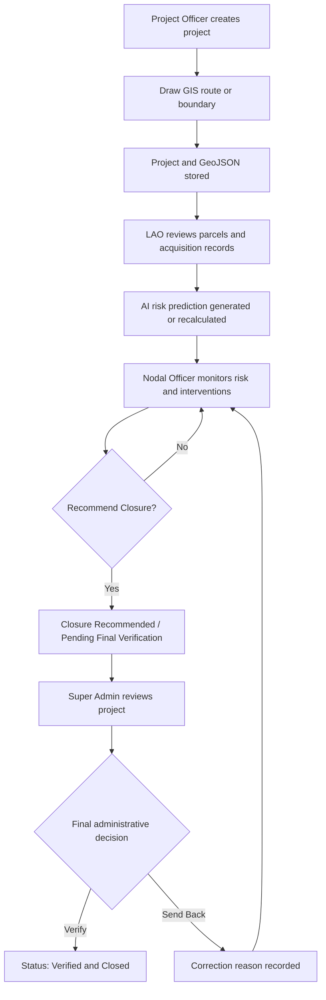

# BhuSetu

BhuSetu is a land-acquisition monitoring platform that combines GIS project mapping, acquisition workflow management, and explainable delay-risk prediction.

## Run The Complete Project

Follow the commands in [commonds.md](commonds.md).

Main URLs:

```text
Frontend: http://localhost:3000
Backend:  http://localhost:8000
API docs: http://localhost:8000/docs
Health:   http://localhost:8000/api/health
```

## GIS Workflow

1. The Project Officer opens **Create Project**.
2. The officer selects a project location type:
   - `linear` for highway, railway, metro, or road projects.
   - `area` for irrigation, industrial, and other area projects.
3. The officer draws a route or polygon on the Leaflet map.
4. The frontend converts the drawing into GeoJSON.
5. The frontend calculates:
   - Project center latitude and longitude.
   - Polygon area in hectares.
   - Route length in kilometers.
6. The project and geometry are sent to the backend.
7. LAO, Nodal Officer, and Super Admin view the same project location.

The application uses OpenStreetMap tiles through Leaflet. GIS is used for project planning and review. It does not modify official cadastral boundaries.

## How GIS Information Is Stored

The backend stores project geometry in the `projects.geometry` JSON column.

A point geometry is stored in GeoJSON format:

```json
{
  "type": "Point",
  "coordinates": [77.209, 28.6139]
}
```

A drawn area is stored as a GeoJSON polygon:

```json
{
  "type": "Polygon",
  "coordinates": [
    [
      [77.20, 28.62],
      [77.22, 28.62],
      [77.22, 28.60],
      [77.20, 28.60],
      [77.20, 28.62]
    ]
  ]
}
```

A drawn route is stored as a GeoJSON line string:

```json
{
  "type": "LineString",
  "coordinates": [
    [77.20, 28.61],
    [77.24, 28.63]
  ]
}
```

GeoJSON uses `[longitude, latitude]` order. Leaflet displays the same coordinates as `[latitude, longitude]`.

The backend also stores the project center and calculated values through the project payload:

```json
{
  "latitude": 28.6139,
  "longitude": 77.209,
  "calculatedArea": "125.40",
  "routeLength": "18.70",
  "geometryType": "Polygon"
}
```

Relevant API endpoints:

```text
POST /api/projects
GET  /api/projects/{id}
GET  /api/projects/{id}/geometry
PUT  /api/projects/{id}/acquisition
PUT  /api/projects/{id}/workflow
```

## Prediction Workflow

Prediction starts with the project and acquisition data.

The backend prepares features such as:

```text
project_type
state
district
tehsil
required_land_area_acres
gis_available
legal_status
ownership_status
compensation_status
rr_status
approval_status
documents_status
```

The configured XGBoost model is loaded from:

```text
machine-learning-algo/land_acquisition_xgb_model.pkl
```

The model metadata is loaded from:

```text
machine-learning-algo/model_metadata.json
```

The prediction returns:

```text
delay_probability
risk_category
top_risk_factors
factor_importance
recommendations
risk_trend
model_version
prediction_source
confidence
```

Risk categories are calculated as:

```text
0-24%   LOW
25-49%  MEDIUM
50-74%  HIGH
75-100% CRITICAL
```

If the trained model is unavailable, BhuSetu uses an explainable rule-based fallback. The fallback gives weighted importance to issues such as:

```text
Legal dispute or case pending       20 points
Ownership verification incomplete   18 points
Compensation incomplete             18 points
R&R actions pending                 14 points
Approval dependency                 12 points
Documents incomplete                10 points
```

The result is never only a score. The system also explains the detected factors and recommends actions.

Prediction endpoints:

```text
POST /api/ai/predict/{project_id}
GET  /api/ai/assessment/{project_id}
GET  /api/ai/history/{project_id}
GET  /api/analytics/risk-distribution
```

Prediction is recalculated when acquisition data is updated through:

```text
PUT /api/projects/{project_id}/acquisition
```

## Where Information Is Stored

### Backend database

By default, the FastAPI backend uses SQLite:

```text
bhusetu.db
```

The database contains the following main records:

```text
projects          Project details, status and GeoJSON geometry
assessments       Current and previous AI assessment results
risk_history      Historical prediction changes and changed fields
interventions    Nodal intervention records
```

The database URL can be changed with:

```powershell
$env:DATABASE_URL = "sqlite:///D:/data/bhusetu.db"
```

### Frontend local demo storage

When the backend is unavailable, the frontend uses browser `localStorage` for demo workflow behavior.

Important keys include:

```text
BhuSetu-ai-workflow-state       Projects, acquisition, interventions and activity
BhuSetu-super-admin-state       Super Admin projects and verification state
BhuSetuUsersData                User records
BhuSetuJurisdictionsData        Jurisdiction records
BhuSetuAdminActivity            Admin audit activity
```

The frontend fallback is useful for demonstrations, but production data should be stored through the backend API and database.

## Complete Business Workflow



### Project Officer

- Creates the project record.
- Enters location and land requirement information.
- Draws the official project planning geometry.
- Uploads project documents.
- Submits the project for acquisition review.

### Land Acquisition Officer

- Reviews candidate parcels.
- Adds or verifies parcel records.
- Updates ownership, compensation, legal, R&R, approval, document, and possession information.
- Submits acquisition updates.
- These changes can trigger a new AI prediction.

### AI Prediction Service

- Reads project, GIS, and acquisition features.
- Calculates delay probability.
- Assigns a risk category.
- Explains the main risk factors.
- Provides recommended next actions.
- Stores assessment history.

### Nodal Officer

- Reviews project progress and AI risk.
- Records interventions and monitoring decisions.
- Tracks pending and resolved actions.
- Selects **Recommend Closure** when monitoring is complete.
- The project moves to `Closure Recommended / Pending Final Verification`.

### Super Admin

- Reviews the complete project folder.
- Reviews project information, acquisition summary, GIS, AI risk, interventions, documents, and activity history.
- Does not edit AI scores, verify parcels, or change legal/acquisition decisions.
- Selects one final action:
  - **Verify Project**: status becomes `Verified` and the project is closed/read-only.
  - **Back to Correction**: a reason is required and the project returns to Nodal Officer review.

## Judge-Friendly Explanation

> BhuSetu connects the physical location of a land project with its administrative acquisition data. The Project Officer draws the route or boundary, the system stores it as GeoJSON, and the LAO records parcel and acquisition progress. The AI evaluates legal, ownership, compensation, R&R, approval, document, and GIS factors to predict delay risk with explanations and recommendations. The Nodal Officer monitors and recommends closure, while the Super Admin performs the final administrative verification or sends the project back for correction.

## Important Data Integrity Rule

GIS overlays shown in the interface are planning and review visualizations. They do not replace or modify official cadastral records. Official land records remain the source of legal truth.
